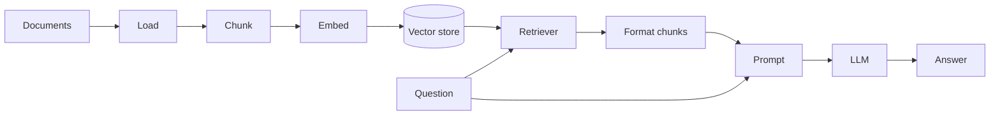

# RAG Learning Notes

Three scripts that build up from raw ChromaDB to a full RAG chat pipeline. Run them from this folder or from the repo root with `uv run`.

| File | What it shows |
|---|---|
| `1-Chromadb_sample.py` | Store text in ChromaDB and query by meaning (default local embeddings, no API key) |
| `2-similarityserach_with_scores.py` | Load markdown, chunk, embed with OpenAI, similarity search with scores |
| `3-complete_rag_pipeline_sample.py` | Full RAG chain with a retriever, prompt, LLM and interactive chat loop |

Scripts 2 and 3 need `OPENAI_API_KEY` in a `.env` file at the repo root. `docs/` holds the markdown knowledge base.

## RAG in one picture



Indexing (load, chunk, embed, store) happens once. Querying (retrieve, prompt, answer) happens for every question.

## Concepts

### Embeddings
A model that turns text into a vector of numbers so that similar meanings are close together. Search compares the question's vector with the stored chunk vectors.
- Chroma default: `all-MiniLM-L6-v2`, runs locally.
- OpenAI: `text-embedding-3-small` or `text-embedding-3-large`.
- The same embedding model must be used for indexing and querying.

### Loaders
Read files into `Document` objects (`page_content` plus `metadata`, such as `source`).
- `TextLoader(path).load()` returns a **list** of Documents. Use `extend`, not `append`, when collecting them.
- `DirectoryLoader(path, glob="**/*.md", loader_cls=TextLoader)` loads every matching file.

### Glob patterns
- `*` matches within one folder level.
- `**` matches any number of folder levels.
- `**/*.md` means every `.md` file under the folder, including subfolders.

### Chunking
Split documents into small pieces before embedding.
- A vector for a whole file is a blurry average, so specific questions match poorly.
- Chunking also keeps the prompt small and avoids embedding-size limits.
- `RecursiveCharacterTextSplitter` splits on paragraphs, then sentences, then characters.
- `MarkdownTextSplitter` prefers heading and paragraph boundaries.
- `chunk_size` is the maximum chunk length in characters. `chunk_overlap` repeats a little text between chunks so ideas are not cut off.

### Vector store (Chroma)
Stores chunks, embeddings and metadata, and finds the nearest vectors.
- No `persist_directory`: in memory, lost when the script ends.
- `persist_directory="vector_store"`: saved to disk. The folder is created automatically, and the path is relative to where you run the script.
- Re-running `from_documents` re-embeds everything, which costs API calls. Open an existing store with `Chroma(persist_directory=..., embedding_function=...)`.
- On Windows, a temp folder used as `persist_directory` can fail on cleanup with `PermissionError: [WinError 32]` because Chroma still holds the file open.

### Similarity search and scores
`similarity_search_with_score(query, k)` returns `(Document, distance)` pairs. A lower distance means a closer match.

### Retriever
`vector_store.as_retriever(search_type="similarity", search_kwargs={"k": 5})`. It takes a question string and returns the top `k` chunks as a list of Documents.

### Runnables and the `|` operator
A `Runnable` is LangChain's common step interface with `.invoke()`, `.batch()` and `.stream()`. Prompts, LLMs, retrievers, parsers and plain functions are all Runnables.
- `a | b` runs `a`, then passes its output to `b`.
- Order matters. Each step expects the type the previous one produces.

### The RAG chain

```python
rag_chain = (
    {"context": retriever | format_retrieved_docs, "question": RunnablePassthrough()}
    | prompt
    | llm
    | StrOutputParser()
)
answer = rag_chain.invoke("your question")
```

| Piece | Job |
|---|---|
| Dictionary | Runs both values on the same question string and builds `{"context": ..., "question": ...}` |
| `retriever \| format_retrieved_docs` | Finds the top chunks, then joins them into one string for `{context}` |
| `RunnablePassthrough()` | Returns the question unchanged for `{question}` |
| `prompt` | `ChatPromptTemplate` that fills `{context}` and `{question}` |
| `llm` | Answers using the filled prompt |
| `StrOutputParser()` | Turns the `AIMessage` response into a plain string |

`format_retrieved_docs` is needed because the retriever returns a list of Documents, but the prompt needs a string.

## Common errors

| Error | Cause and fix |
|---|---|
| `CERTIFICATE_VERIFY_FAILED` while Chroma downloads its model | Corporate proxy. Run `uv add truststore` and call `truststore.inject_into_ssl()` before importing `chromadb` |
| `'list' object has no attribute 'page_content'` | Documents were appended as lists. Use `extend` |
| `PermissionError: [WinError 32]` on `data_level0.bin` | Temp directory cleanup while Chroma holds the file. Omit `persist_directory` or use a fixed folder |
| `unexpected keyword argument 'texts'` | Chroma's `upsert` uses `documents=`, not `texts=` |
